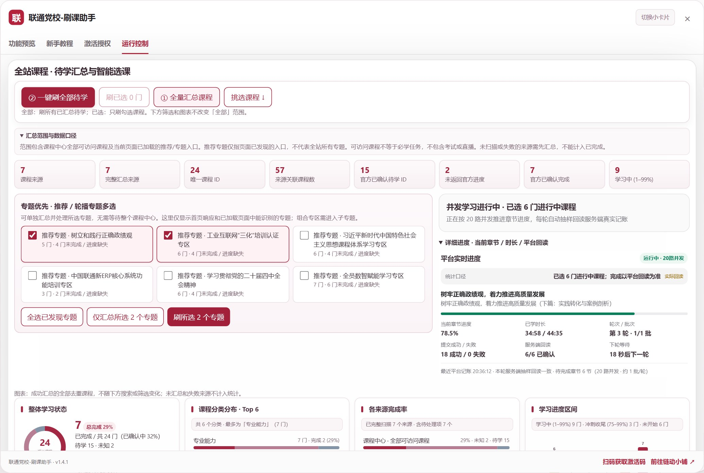
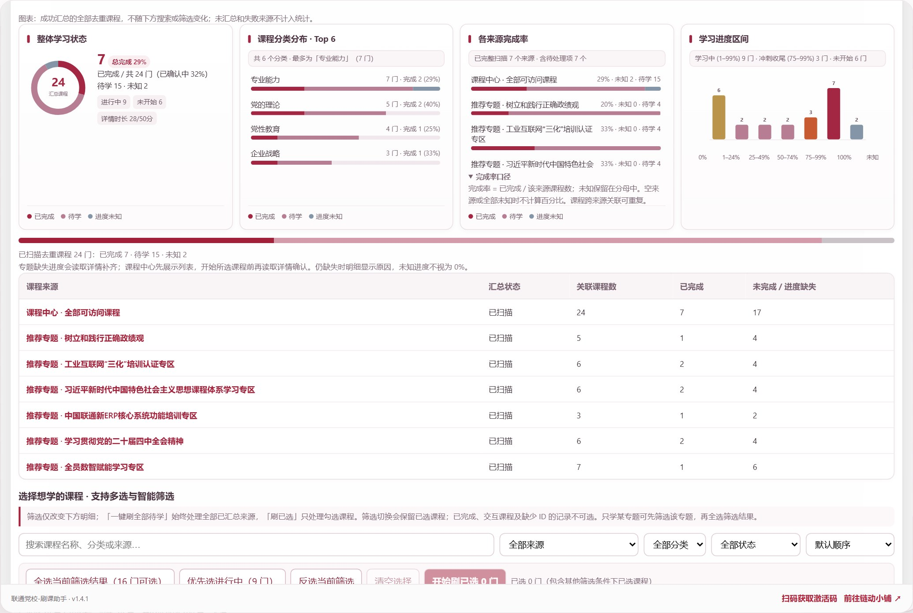
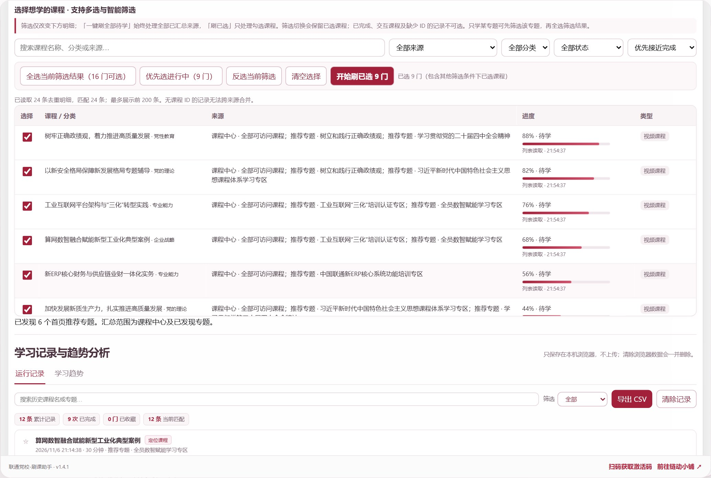
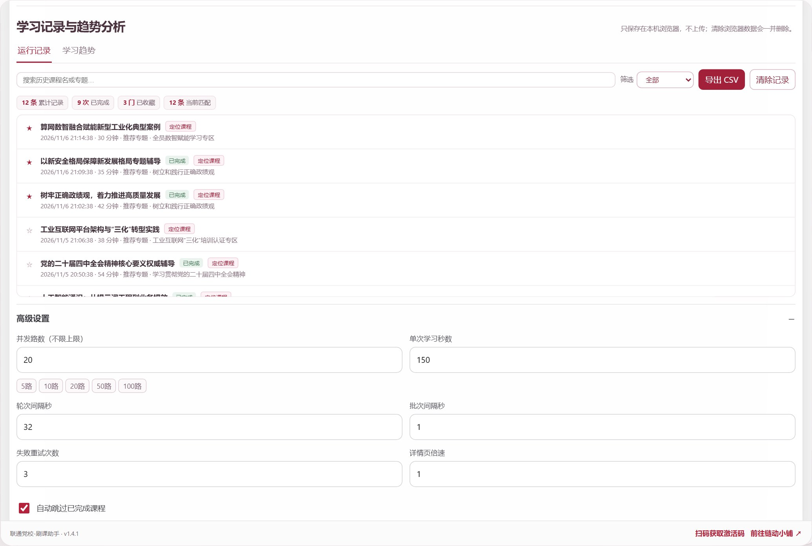
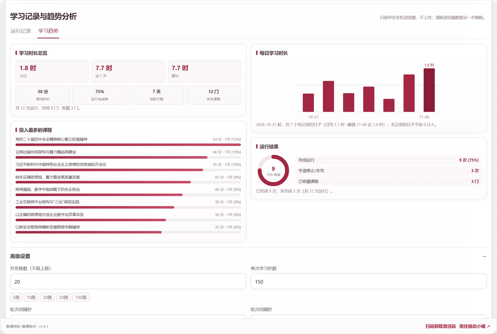

# 联通党校-刷课助手

永久使用授权 · 每个激活码最多绑定 4 个浏览器配置 · 持续更新（当前版本 **v1.4.1**）

把全站课程汇总、专题优先多选、智能课程筛选排序、实时并发进度回读，以及**本地学习记录与四维学习趋势分析**整合在一个宽屏高密度工作台里，也可随时切换小卡片模式。

## v1.4.1 界面与功能展示截图

以下五张图片为 **v1.4.1 授权版** 模拟展示截图（使用脱敏演示课程与模拟学习记录展示新版排版、图表、无上限并发预设与学习趋势面板；公开授权版需输入激活码启用课程功能）。

### 1. 全站汇总与 8 维统计卡片 · 专题优先与实时进度同屏

顶部 8 维统计卡片直观呈现课程来源、完整汇总来源、唯一课程 ID、来源关联课程数、官方已确认待学、未返回官方进度、**官方已确认完成**与**学习中 (1–99%)** 数量。左侧可独立勾选推荐/轮播专题优先汇总；右侧同屏展示当前并发进度、已学时长、服务端抽样回读及剩余章节批次估算。

### 2. 四维课程总览图表 · 完成率胶囊、状态标签与来源明细

四类高信息密度图表一行排布：
- **整体学习状态**：环形图搭配总完成率胶囊、已确认口径占比，以及进行中、未开始、详情章节时长标签。
- **课程分类分布 · Top 6**：展示各分类课程总量、已完成门数及分类完成率百分比。
- **各来源完成率**：按课程中心与各专题分别展示完成率、待学数与未知数。
- **学习进度区间**：7 段进度分布柱状图，顶部汇总学习中 (`1–99%`)、冲刺收尾 (`75–99%`) 与未开始课程数。

### 3. 智能课程明细表 · 6 种排序、一键选进行中与行内可视化进度条

课程明细表新增粘性筛选栏与 **6 种排序方式**（默认顺序、**优先接近完成**、进度从高到低、进度从低到高、多来源关联优先、按名称排序），状态筛选支持直接查看**进行中 (1–99%)**。提供「全选当前筛选结果」「**优先选进行中**」「**反选当前筛选**」快捷操作，每门课程配有行内可视化进度条与课程类型徽章。

### 4. 本地学习记录检索 · 不设上限并发与快捷档位预设

- **本地学习记录**：自动记录每次运行的课程、所属专题、学习时长与完成状态（仅保存在当前浏览器本地），支持关键词搜索、按状态/收藏筛选、一键定位到课程明细表及导出 CSV。
- **并发路数不设上限**：高级设置移除 10 路并发上限，支持任意正整数并发，并提供 **5路 / 10路 / 20路 / 50路 / 100路** 一键快捷预设。

### 5. 四维学习趋势分析 · 时长总览、每日柱状图、常学排行与完成率环图

切换到「学习趋势」即可查看基于本地记录实时汇总的四张趋势卡片：
- **学习时长总览**：今日、近 7 天、累计时长 + **场均时长、运行完成率、活跃天数、涉及课程**四项二级指标。
- **每日学习时长**：近 14 日柱状趋势图，自动标出峰值柱与日均参考虚线。
- **投入最多的课程**：按累计时长排行展示常学课程、运行次数与时长占比。
- **运行结果分布**：完成率环形图与完成运行、中途停止/未完、已收藏课程对照清单。

## 可以怎样使用

- **全量模式**：手动汇总课程中心全部可访问课程及已发现专题，再一键处理全部待学队列，重复课程按 ID 自动合并。
- **专题优先**：在独立的专题区多选首页推荐、轮播中可识别的专题，仅汇总所选专题，再刷所选专题，无需先等整个课程中心汇总完成。
- **课程自选与冲刺收尾**：按专题来源、课程分类、完成状态（如「进行中 1–99%」）和排序方式（如「优先接近完成」）筛选，点击「优先选进行中」或逐门勾选，再点击「开始刷已选 N 门」。
- **当前专题**：直接进入具体专题页面后，在运行控制顶部点击「▶ 一键开始刷当前专题」，只处理当前专题的待学课程；停止按钮位于同一区域。

## 页面响应与展开方式

课程分页请求异步执行，每批最多调度 12 页、同时读取 4 页，批次之间让出浏览器执行机会。课程明细每批渲染 25 行；筛选复用统计图，勾选课程只更新选择状态。扫描状态约 100 毫秒合并更新，课程回读约 250 毫秒合并刷新，以减少重复绘制。

高级设置、范围说明、进度详情、图表口径及教程问答默认展开，可手动收起。新手教程内嵌离线操作截图，明确标注为演示课程数据。

## 进度如何更新

专题列表缺少官方课程进度时，会进一步读取课程详情尝试补齐。课程中心全量汇总先展示完整列表，不逐门补读全库详情；开始所选课程前会读取详情确认，缺失的官方进度保持未知。章节详情返回的已学秒数单独展示，不将章节时长比例冒充官方课程完成率。

任务中展示当前课程、当前章节、章节进度、已学时长、轮次与批次、提交成功和失败数、服务端回读、最后记账时间及**剩余章节与并发批次估算**。实际完成以平台回读结果为准。

## 三种执行范围不要混淆

- **「一键刷全部待学」**：处理全部完整汇总来源中的待学课程。
- **「刷已选 N 门」**：仅处理勾选课程；切换筛选条件会保留已选课程，可清空后重新选择。
- **「刷所选 N 个专题」**：仅处理所选专题里的可处理待学课程，跨专题重复课程只加入一次。

## 安装与激活

1. 在 Edge 或 Chrome 中安装并启用 Tampermonkey。
2. 安装本页公开授权版脚本，登录联通党校。
3. 在「激活授权」输入激活码。同一浏览器配置的多个标签不重复占名额。
4. 首页选择全量、专题或课程模式，先汇总再手动开始。默认 10 路并发，可在高级设置中自由调整并发路数（不设上限，支持 5/10/20/50/100 路快捷预设）。
5. 运行中可随时停止。当前页面通过「继续上次暂停队列」恢复；首页刷新后需要重新汇总。

## 授权与购买

永久使用授权，每码最多 4 个浏览器配置。清空脚本数据或换浏览器配置可能被识别为新绑定；名额已满时联系卖家处理。

[获取激活码 · 链动小铺](https://wzyp.cn/shop/2U92NO5U/nh6hd3)

## 使用范围

需要自己的平台账号和正常联网。可访问课程不等于必学任务；不包含考试或直播。组合专区需进入子专题识别。交互课程及平台未提供可处理章节的课程，会提示在原平台学习。课程明细单次展示前 200 条；搜索和全选筛选结果基于已汇总数据，不只限于当前展示的 200 条。

仅使用一个版本，不要同时启用多个旧版或公开版与自用版。

## 授权校验与使用统计

授权有效期内会提前复查，单次校验最长有效 5 分钟；保留使用统计。授权及统计向 `license.ddtgm.cn` 发送激活码、随机浏览器编号；统计另含随机页面会话编号、脚本版本和任务运行状态，用于使用数量与趋势。不会向授权服务上传党校账号密码、Cookie、课程内容或本地学习记录。

## 版本更新记录

### v1.4.1 更新
- **移除并发 10 路上限**：恢复并发路数不封顶（默认 10 路，支持任意正整数），并在高级设置新增 `5路 / 10路 / 20路 / 50路 / 100路` 快捷档位按钮与实时剩余章节批次估算。
- **总览与课程明细升级**：顶部升级为 8 维统计卡片（新增官方已确认完成与学习中 `1–99%` 卡片）；明细表新增粘性工具栏、6 种排序（含「优先接近完成」）、进行中状态筛选、「优先选进行中 / 反选当前筛选」快捷按钮及行内可视化进度条。
- **四维总览图表信息增强**：新增总完成率胶囊、已确认口径完成率、进行中/未开始/章节时长 KPI 标签、分类完成率统计及进度区间冲刺汇总。
- **学习记录与趋势分析增强**：运行记录支持关键词搜索、未完成筛选、统计摘要条及一键「定位课程」；学习趋势图新增场均时长、运行完成率、活跃天数、涉及课程指标，每日趋势图增加日均参考虚线与峰值高亮。

### v1.4.0 更新
- 新增本地学习记录面板（运行历史、收藏、状态筛选、CSV 导出）与学习趋势四图（时长总览、每日柱状图、常学课程排行、完成情况环形图）。

### v1.3.3 更新
- 具体专题的一键开始按钮移到运行控制顶部，显示执行范围，运行中可在同一区域停止；课程中心全量汇总先展示完整列表，开始所选课程前再读取详情确认。
